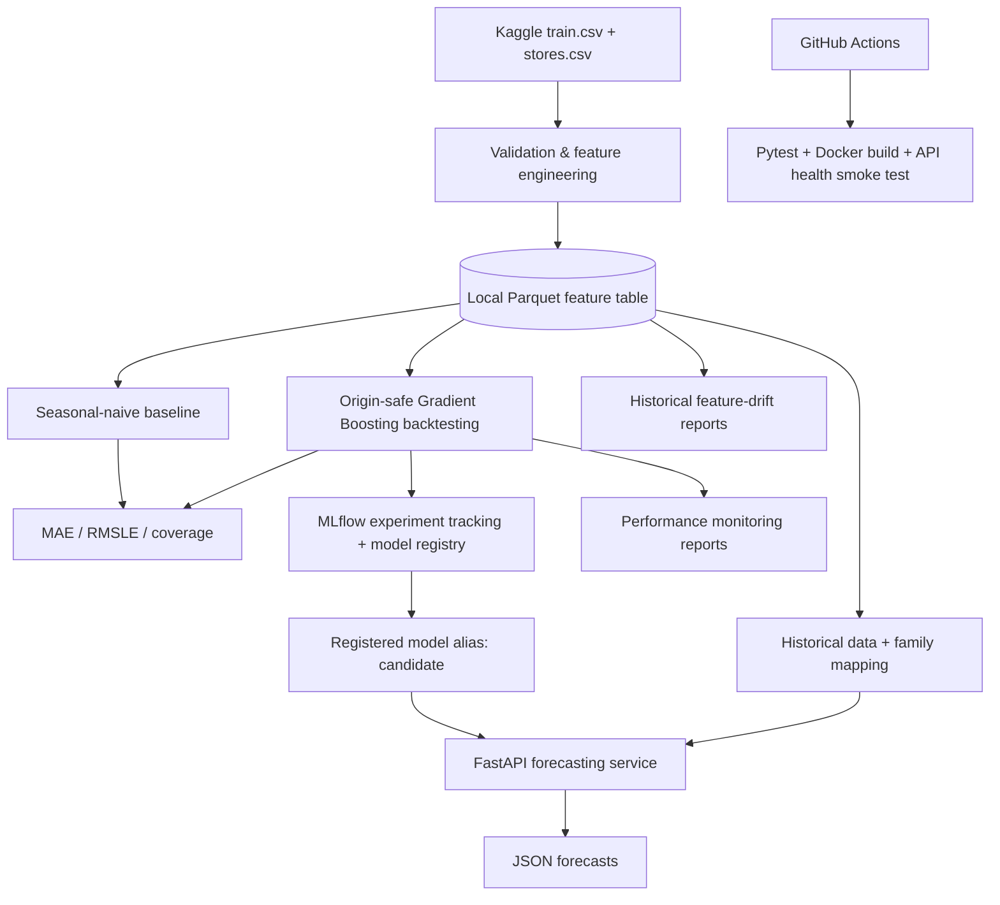
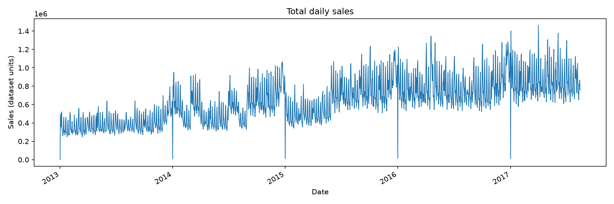
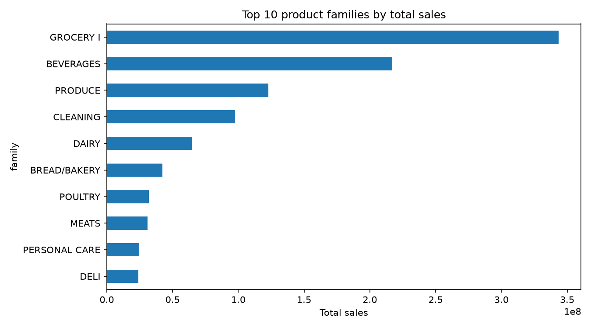
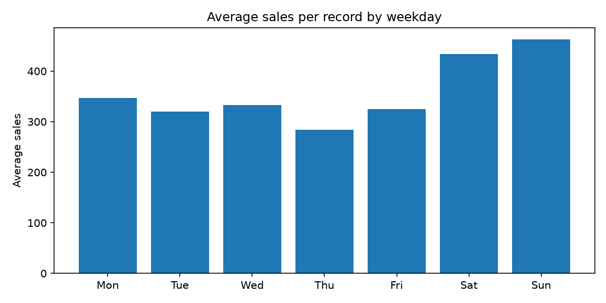

# Sales Forecasting & MLOps Platform

[](https://github.com/bryandhpir/sales-forecasting-mlops-platform/actions/workflows/python-ci.yml)


**An end-to-end learning project for retail unit-sales forecasting, reproducible model evaluation, experiment tracking, API inference, containerization, automated tests, and historical monitoring.**

Built with the [Kaggle Store Sales – Time Series Forecasting dataset](https://www.kaggle.com/competitions/store-sales-time-series-forecasting/data) (Corporación Favorita, Ecuador). Forecasts are generated **per store and product family**, with special attention to temporal leakage, reproducibility, and observable model behavior.

> **Status (November 2026):** Working local ML/MLOps prototype. Feature engineering, baseline and Gradient Boosting backtesting, MLflow model loading, FastAPI inference, Docker Compose, GitHub Actions CI, and historical monitoring scripts are implemented. **Not a cloud-hosted or production-grade service.** The trained model, MLflow database/artifacts, and Kaggle data are local and deliberately not committed.

## Highlights

| Area | Implemented capability |
| --- | --- |
| Data processing | Validation, store metadata integration, calendar-aligned lags, rolling aggregates, Parquet output |
| Forecasting | Seasonal-naive baseline; `HistGradientBoostingRegressor` using origin-safe historical snapshots |
| Evaluation | Time-ordered, non-overlapping backtesting; MAE, RMSLE, and scored-target coverage |
| Model management | MLflow experiments/model registry; model alias `candidate` used by the API |
| Serving | FastAPI `POST /predict` and `GET /health`; configurable request horizon up to **7** evaluated days |
| Containers | Separate FastAPI and MLflow images coordinated with Docker Compose |
| CI | Pytest, Docker Compose validation, API image build, and container `/health` smoke test |
| Monitoring | Historical KS-based feature drift, segmented store/family reports, and backtest performance summaries |

## Recorded results

### Dataset

| Item | Observed locally |
| --- | ---: |
| Historical sales records | **3,000,888** |
| Stores | **54** |
| Product families | **33** |
| Available sales dates | **2013-01-01 to 2017-08-15** |

The target is **`sales` (units sold)**, **not revenue**. The series key is `store_nbr + family`.

### Gradient Boosting: saved backtesting run

The committed [historical performance report](reports/monitoring/model_performance.json) summarizes a previously executed backtest with **three evaluation cutoffs** and a **7-day forecast horizon**. The evaluation covered 37,422 observed store–family targets; all had a scored prediction.

| Metric | Recorded value |
| --- | ---: |
| Mean Absolute Error (MAE) | **79.014** sales units |
| Root Mean Squared Logarithmic Error (RMSLE) | **0.4488** |
| Scored-target coverage | **100%** (37,422 / 37,422) |

| Forecast cutoff | Scored targets | MAE | RMSLE |
| --- | ---: | ---: | ---: |
| 2017-07-25 | 12,474 | 91.224 | 0.4503 |
| 2017-08-01 | 12,474 | 76.254 | 0.4591 |
| 2017-08-08 | 12,474 | 69.564 | 0.4369 |

**Interpretation:** MAE decreased across these three historical cutoffs, but three observations are not sufficient to demonstrate lasting improvement or production performance. Metrics are associated with this **specific saved run**; results from other experimental configurations should not be treated as directly comparable. The coverage figure means a prediction exists for each observed evaluation target; it is **not** a prediction-interval coverage metric.

### Historical feature-drift experiments

The [aggregate drift report](reports/monitoring/feature_drift.json) compares June 2017 with July 2017:

| Feature | KS statistic | Flagged at exploratory threshold 0.20? |
| --- | ---: | --- |
| `sales_lag_7` | 0.0046 | No |
| `sales_rolling_mean_7` | 0.0069 | No |

At the **store–family** level, a separate April–May versus June–July 2017 comparison flagged **1,322 of 1,782** combinations (74.2%) on at least one feature. See [segmented drift report](reports/monitoring/segmented_drift.csv); the [earlier June–July comparison](reports/monitoring/segmented_drift_jun_jul.csv) is also preserved.

**Caution:** These are *exploratory historical distribution checks*, not proof of model failure. The rolling features are correlated over time; the reference windows, seasonal patterns, zero sales, and the deliberately simple KS threshold affect alert counts. A flag is a reason to investigate, **not an automatic retraining decision**.

## Architecture



**Inference flow:** request validation → future calendar → family encoding → historical snapshot at cutoff → feature alignment to the trained model → log-scale inference → nonnegative unit-sales forecast → JSON response.

The API and MLflow server have dedicated Docker images, managed in [`compose.yaml`](compose.yaml). The CI smoke test starts **only the API image** and checks `/health`; it does **not** exercise the live model registry or `/predict` in GitHub Actions.

## Technical design decisions

**1. Forecast-origin safety.** A historical evaluation row is never allowed to take observed future sales or future-row lag values as input. Each prediction uses calendar attributes of the target date and sales information available **on or before its cutoff**. Training targets and evaluation targets occupy separate chronological intervals.

**2. Calendar-correct lookups.** Lag features refer to exact earlier calendar dates. Missing records are preserved as missing rather than silently reinterpreted as zero sales.

**3. Prediction-time parity.** The serving pipeline reconstructs the historical reference and cutoff snapshot using the same feature logic as the backtest. Trained feature ordering is enforced through `model.feature_names_in_`.

**4. Explicit scope.** Training accepts a configurable horizon; the current API limits requests to **1–7 days**, reflecting the validated serving configuration rather than claiming reliable predictions at arbitrary horizons.

## Project structure

```text
sales-forecasting-mlops-platform/
├── .github/workflows/python-ci.yml    # Unit tests + Docker/API smoke test
├── data/raw/                         # Downloaded Kaggle CSVs (not tracked)
├── data/processed/                   # Feature table & local model reports (not tracked)
├── docs/                             # Baseline / model-training notes
├── notebooks/                        # EDA, model experiments, inference checks
├── reports/
│   ├── figures/                      # Committed EDA figures
│   └── monitoring/                   # Selected historical reports
├── src/
│   ├── data_pipeline.py              # Data validation + feature engineering
│   ├── baseline.py / backtesting.py  # Baseline and chronological evaluation
│   ├── train_model.py                # Gradient Boosting training + backtest
│   ├── forecast_features.py          # Cutoff-safe inference features
│   ├── inference.py                  # Predict from aligned model features
│   ├── forecast_pipeline.py          # End-to-end forecasting logic
│   ├── api.py                        # FastAPI endpoints + MLflow model loading
│   ├── monitoring.py                 # Historical feature KS comparisons
│   ├── monitoring_report.py          # Aggregate JSON report CLI
│   ├── segmented_monitoring.py       # Store/family drift CSV CLI
│   └── performance_monitoring.py     # Saved-backtest performance CLI
├── tests/                            # Unit, mocked integration, opt-in live tests
├── Dockerfile                        # FastAPI image
├── Dockerfile.mlflow                 # MLflow server image
├── compose.yaml                      # Local two-service stack
├── requirements.txt
└── requirements-api.txt
```

## Reproduce the data and evaluation workflow

The commands below target **Windows PowerShell** from the repository root. Python **3.13** was used in development. Kaggle data and trained model artifacts must be obtained or generated locally; a clean clone **does not** contain them.

### 1. Environment and dataset

```powershell
git clone https://github.com/bryandhpir/sales-forecasting-mlops-platform.git
cd sales-forecasting-mlops-platform
py -3.13 -m venv .venv
.\.venv\Scripts\python.exe -m pip install -r requirements.txt -r requirements-api.txt httpx
```

Download `train.csv` and `stores.csv` from the [competition data page](https://www.kaggle.com/competitions/store-sales-time-series-forecasting/data) and place both in `data/raw/`. The files are not redistributed in this repository.

### 2. Feature generation, EDA, and backtesting

```powershell
.\.venv\Scripts\python.exe -m src.data_pipeline
.\.venv\Scripts\python.exe -m src.eda

# Historical baseline and gradient-boosting evaluation
.\.venv\Scripts\python.exe -m src.backtesting --horizon 7 --origins 3
.\.venv\Scripts\python.exe -m src.train_model --horizon 7 --origins 3 --train-origins 12
```

Outputs include `data/processed/features.parquet`, `baseline_metrics.json`, `gradient_boosting_backtest.parquet`, and `gradient_boosting_metrics.json`. Exact numerical results depend on the executed configuration and environment. Evaluation scripts do **not** automatically populate a fresh MLflow Model Registry with the `candidate` alias.

### 3. Historical monitoring

```powershell
# Aggregate feature drift: June vs July 2017
.\.venv\Scripts\python.exe -m src.monitoring_report `
  --reference-start 2017-06-01 --reference-end 2017-06-30 `
  --current-start 2017-07-01 --current-end 2017-07-31

# Segmented store/family drift: April–May vs June–July 2017
.\.venv\Scripts\python.exe -m src.segmented_monitoring `
  --reference-start 2017-04-01 --reference-end 2017-05-31 `
  --current-start 2017-06-01 --current-end 2017-07-31

# Summarize metrics from the saved Gradient Boosting backtest
.\.venv\Scripts\python.exe -m src.performance_monitoring
```

These commands create or overwrite local files under `reports/monitoring/`. The performance summary currently provides **overall, per-cutoff, and per-family** statistics; per-store/per-horizon charts and a monitoring UI are **not implemented in this repository**.

## FastAPI inference

`src/api.py` exposes:

| Method | Path | Behavior |
| --- | --- | --- |
| `GET` | `/health` | Process health (`{"status":"ok"}`); does not load/test the model |
| `POST` | `/predict` | Validates cutoff, store, family, and horizon; returns daily unit-sales predictions |

Example request:

```json
{
  "cutoff": "2017-08-15",
  "store_nbr": 1,
  "family": "BEVERAGES",
  "horizon": 7
}
```

**Local serving prerequisites:**

1. `data/processed/features.parquet` exists.
2. `data/processed/family_mapping.json` contains the same family→integer encoding used by `prepare_data()` during training.
3. A reachable MLflow server contains a registered model named `sales_forecasting_gradient_boosting` with alias **`candidate`** and accessible model artifacts. The code loads `models:/sales_forecasting_gradient_boosting@candidate`.

The mapping and the registered model are **not** provided by the public Git repository. Experiment logging/registration was carried out in local MLflow workflows; running the training CLI alone does not create these serving prerequisites. Missing resources produce HTTP **503** rather than a forecast.

If you do not already have a saved `family_mapping.json`, recreate the categorical mapping **from the complete feature table** (do not derive it from only the requested store/family):

```powershell
@'
import json
from pathlib import Path
import pandas as pd
from src.train_model import SOURCE_COLUMNS, prepare_data

root = Path("data/processed")
raw = pd.read_parquet(root / "features.parquet", columns=SOURCE_COLUMNS)
prepared = prepare_data(raw)
pairs = prepared[["family", "family_code"]].drop_duplicates()
mapping = {str(family): int(code) for family, code in pairs.itertuples(index=False, name=None)}
(root / "family_mapping.json").write_text(
    json.dumps(mapping, indent=2), encoding="utf-8"
)
print("Mapped product families:", len(mapping))
'@ | .\.venv\Scripts\python.exe -
```

This must match the encoding used when the model was trained. **It does not create, register, or validate a new model.**

For local Python serving after setting up MLflow:

```powershell
$env:MLFLOW_TRACKING_URI = "http://127.0.0.1:5000"
.\.venv\Scripts\python.exe -m uvicorn src.api:app --host 127.0.0.1 --port 8000
```

Open [http://127.0.0.1:8000/docs](http://127.0.0.1:8000/docs) for interactive API documentation.

## Docker Compose (optional local deployment)

The Compose stack uses:

- **`mlflow`**: port `127.0.0.1:5000`, SQLite backend and local artifacts via `./mlflow-docker-data`.
- **`api`**: port `127.0.0.1:8002`, model service communicating with `http://mlflow:5000`, and a read-only bind mount of `./data/processed`.

**Before starting:** restore or prepare the local MLflow Registry database **and** its matching model artifacts in `mlflow-docker-data/`, plus the feature table and family mapping in `data/processed/`. Simply running Compose on a fresh clone starts services but **does not recreate the registered trained model**. Keep original artifact/SQLite backups when migrating MLflow storage.

```powershell
docker compose config --quiet
docker compose up --build -d
docker compose ps
```

Service URLs: [FastAPI Swagger](http://127.0.0.1:8002/docs) · [MLflow UI](http://127.0.0.1:5000).

Stop services **without deleting the bind-mounted model files**:

```powershell
docker compose down
```

To remove project-specific local images without deleting source files or model backups:

```powershell
docker image rm sales-forecast-api:local sales-forecast-mlflow:local
```

Docker is **optional for analysis, model evaluation, and historical monitoring**. The source repository remains usable when these local containers/images have been removed.

## Testing and CI

```powershell
# Default: independent tests and mocked API/pipeline integration
.\.venv\Scripts\python.exe -m pytest -q

# Optional: exercise a running local Docker stack with actual model/data
$env:RUN_LIVE_STACK = "1"
$env:API_BASE_URL = "http://127.0.0.1:8002"
.\.venv\Scripts\python.exe -m pytest tests/test_live_stack.py -v
Remove-Item Env:RUN_LIVE_STACK
```

The [GitHub Actions workflow](.github/workflows/python-ci.yml) runs on push/PR/manual dispatch and includes:

1. Python 3.13 dependency installation and Pytest; live stack tests excluded.
2. Docker Compose syntax validation, FastAPI image build, container startup, and `/health` smoke test with retries.

**CI scope:** passing these jobs demonstrates source tests and basic container boot behavior. It does **not** run a real `/predict` request against a registered model on GitHub-hosted runners, publish an image, or deploy the service to the cloud.

## EDA figures

| Historical sales | Top product families | Day-of-calendar pattern |
| --- | --- | --- |
|  |  |  |

## Known limitations and next steps

- **Not production-hosted:** the working configuration is local; no public endpoint, authentication, access control, or managed secrets/deployment pipeline.
- **Artifact portability:** Kaggle source data, processed Parquet, MLflow backend/artifacts, and family mappings are excluded from Git. A new machine requires local reconstruction/restoration.
- **Model validation:** the highlighted numbers come from one saved historical backtest; a broader time-origin and seasonal evaluation would improve confidence. No uncertainty intervals are served.
- **Monitoring scope:** historical comparison scripts, **not** live prediction/label collection, automatic drift alerting, or continuous production model monitoring. The simple KS threshold needs calibration, particularly across many short, correlated series.
- **Feature scope:** the training model chiefly uses calendar and historical sales signals; additional known-in-advance external features could be evaluated separately.
- **Future work:** per-store/per-horizon performance views, more robust drift triage, richer monitoring visualization, error analysis, and deployment-hardening.

## Documentation and data credit

- [Baseline methodology](docs/BASELINE.md) and [Gradient Boosting training notes](docs/MODEL_TRAINING.md) (earlier design notes; this README reflects the newer repository scope).
- [Aggregated drift JSON](reports/monitoring/feature_drift.json), [segmented drift CSV](reports/monitoring/segmented_drift.csv), [backtest performance JSON](reports/monitoring/model_performance.json).
- Data: [Kaggle — Store Sales: Time Series Forecasting](https://www.kaggle.com/competitions/store-sales-time-series-forecasting/data), originally published for Corporación Favorita. Respect dataset terms; raw files are not redistributed here.

---

**Project type:** Personal machine-learning engineering / MLOps portfolio prototype. **Author:** [bryandhpir](https://github.com/bryandhpir).
